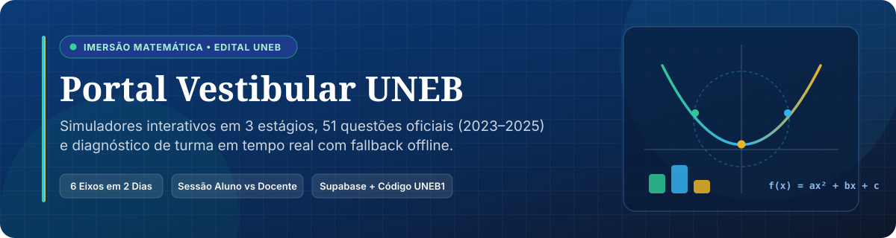
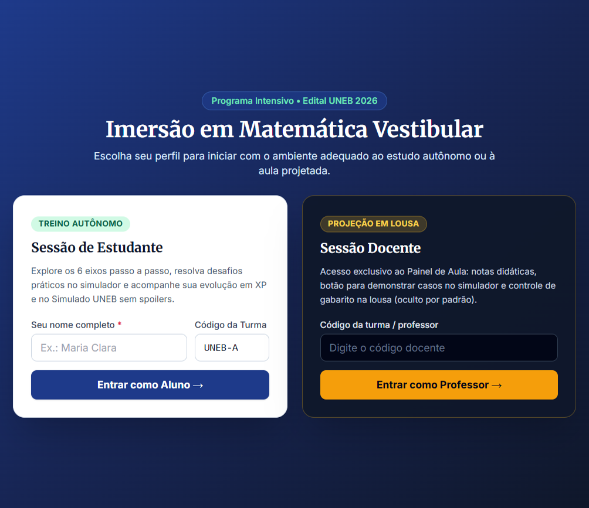
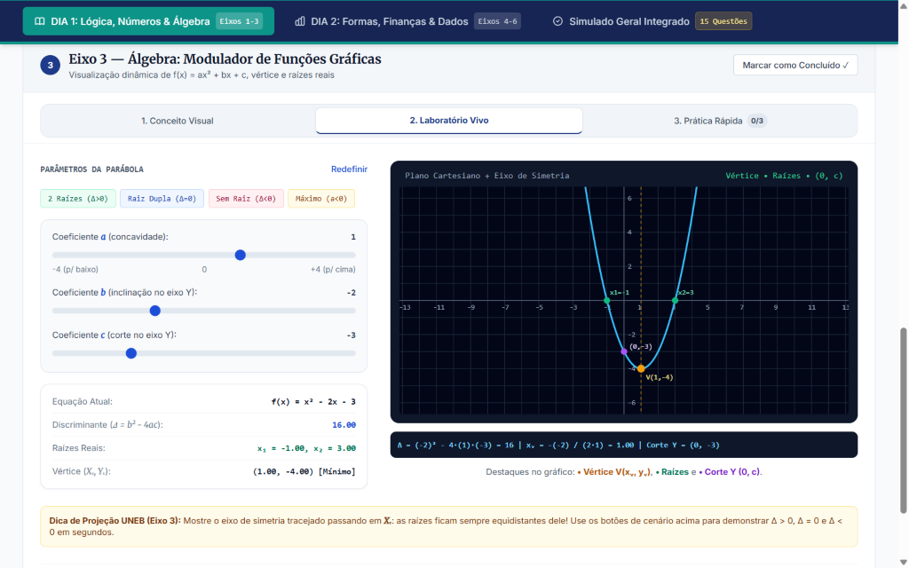
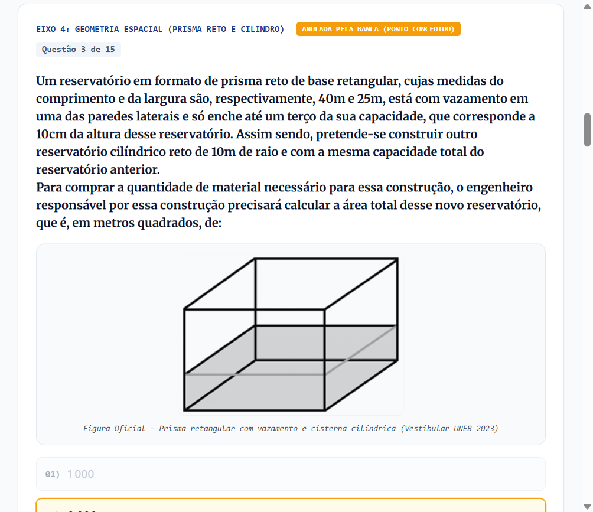
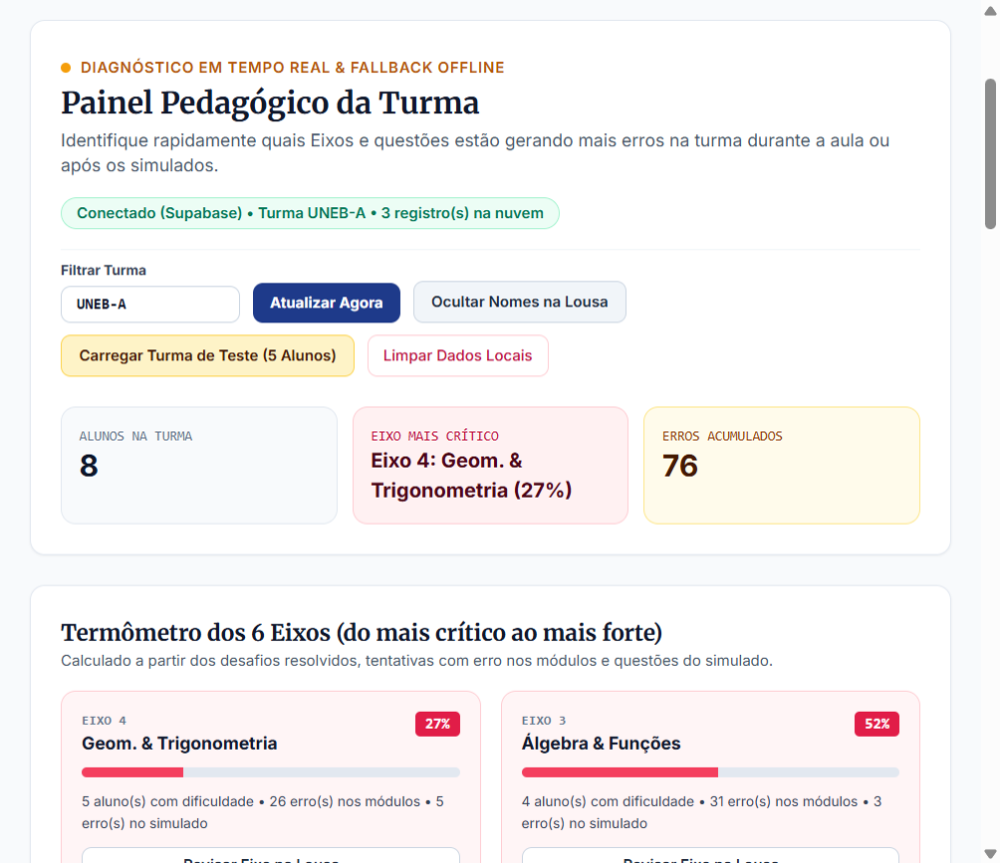
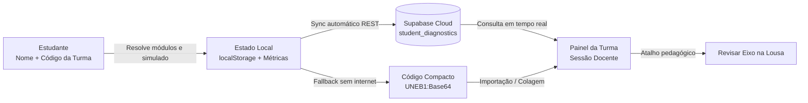

<div align="center">
  

  <br /><br />

  [](https://vest-uneb.vercel.app)
  [](#arquitetura-h%C3%ADbrida--diagn%C3%B3stico-da-turma)
  [](#estrutura-do-reposit%C3%B3rio)
  [](#estrutura-do-reposit%C3%B3rio)
  [](LICENSE)

  <p align="center">
    <strong>Plataforma web interativa para revisão intensiva de Matemática do Vestibular UNEB (2º Dia)</strong><br />
    Com simuladores dinâmicos em Canvas 2D, 51 questões oficiais comentadas, modo aula para lousa e diagnóstico da turma em tempo real.
  </p>

  <p align="center">
    <a href="https://vest-uneb.vercel.app"><strong>Acessar Portal ao Vivo →</strong></a>
    &nbsp;•&nbsp;
    <a href="#pr%C3%A9via-da-plataforma">Telas</a>
    &nbsp;•&nbsp;
    <a href="#trilha-pedag%C3%B3gica-6-eixos-em-2-dias">Trilha de Estudos</a>
    &nbsp;•&nbsp;
    <a href="#como-usar-em-sala-de-aula">Guia Sala de Aula</a>
    &nbsp;•&nbsp;
    <a href="#execu%C3%A7%C3%A3o-local-e-testes">Rodar Localmente</a>
  </p>
</div>

---

## Sobre o Projeto

O **Portal Vestibular UNEB** foi desenvolvido para unir **didática de sala de aula (projeção em lousa)** e **estudo autônomo dos alunos** em uma aplicação web leve, modular e sem dependências de runtime no cliente.

### Principais Diferenciais
- **Separação de Perfis (`Sessão Estudante` vs. `Sessão Docente`):** estudantes resolvem desafios e simulados sem spoilers; docentes projetam exemplos interativos, controlam o gabarito na lousa e visualizam notas didáticas.
- **Módulos em 3 Estágios Progressivos:** cada um dos **6 Eixos** do edital segue a trilha **1. Conceito Visual → 2. Laboratório Vivo (Canvas/Simulador) → 3. Prática Rápida (3 desafios)**.
- **Banco Oficial Verificado (51 questões e 17 figuras):** questões das provas **UNEB 2023, 2024 e 2025** mais bateria de **Imersão & Fixação**, respeitando anulações e retificações oficiais de gabarito.
- **Diagnóstico Híbrido da Turma:** sincronização automática na nuvem (**Supabase**) por código de turma e **código compacto offline (`UNEB1:...`)** para turmas sem internet estável.

---

## Prévia da Plataforma

<table>
  <tr>
    <td width="50%" align="center">
      <br />
      <sub><strong>1. Portal de Entrada:</strong> perfis separados com identificação por Nome e Código da Turma.</sub>
    </td>
    <td width="50%" align="center">
      <br />
      <sub><strong>2. Laboratório Vivo (Canvas 2D):</strong> manipulação em tempo real de raízes, vértice e concavidade.</sub>
    </td>
  </tr>
  <tr>
    <td width="50%" align="center">
      <br />
      <sub><strong>3. Simulado Oficial UNEB:</strong> questões com figuras reais, cronômetro e resolução comentada.</sub>
    </td>
    <td width="50%" align="center">
      <br />
      <sub><strong>4. Painel da Turma (Docente):</strong> termômetro dos 6 Eixos do mais crítico ao mais forte.</sub>
    </td>
  </tr>
</table>

---

## Trilha Pedagógica (6 Eixos em 2 Dias)

| Dia / Modo | Eixos e Conteúdos | Recursos Interativos |
| :--- | :--- | :--- |
| **DIA 1** <br />`Manhã 1` | **Eixo 1:** Lógica Matemática <br />**Eixo 2:** Números, Sequências (PA/PG) e Combinatória <br />**Eixo 3:** Álgebra e Funções | Tabela-verdade interativa, laboratório de arranjo vs. combinação e modulador cartesiano de parábola ($ax^2+bx+c$) |
| **DIA 2** <br />`Tarde 2` | **Eixo 4:** Geometria e Trigonometria <br />**Eixo 5:** Matemática Financeira e Proporções <br />**Eixo 6:** Tratamento da Informação (Estatística) | Ciclo trigonométrico interativo, simulador de juros compostos em gráfico e cálculo com Regra de Sturges |
| **SIMULADO** <br />`Geral` | **4 edições integradas (51 questões):** <br />`UNEB 2025` (15) • `UNEB 2024` (15) • `UNEB 2023` (15) • `Imersão` (6) | Modo Estudo (feedback imediato) ou Modo Prova (cronômetro de 60 min), com figuras oficiais |
| **DOCENTE** <br />`Painel da Turma` | Diagnóstico consolidado da turma filtrada por código | Ranking dos eixos com maior erro, questões mais erradas, filtro de privacidade (*Ocultar Nomes*) e botão *"Revisar Eixo na Lousa"* |

---

## Arquitetura Híbrida & Diagnóstico da Turma



### Decisões Técnicas
- **Zero Dependências de Runtime:** construído em **JavaScript ES6 Modules** (`js/app.js`, `js/state.js`, `js/modules/*`), facilitando hospedagem estática instantânea na Vercel ou abertura local.
- **CSS Compilado Estático:** `css/app.css` gerado via Tailwind CSS CLI com fallback de fontes de sistema caso o usuário esteja offline.
- **Resiliência em Sala de Aula:** caso o Wi-Fi da escola falhe, o aluno gera um código `UNEB1:...` (payload UTF-8 compactado em Base64) que o professor importa direto no **Painel da Turma**.

---

## Como Usar em Sala de Aula

### Para Estudantes
1. Acesse **[vest-uneb.vercel.app](https://vest-uneb.vercel.app)**.
2. Na **Sessão de Estudante**, informe seu **nome completo** e o **código da turma** combinado pelo professor (padrão: `UNEB-A`).
3. Avance pelos módulos do **Dia 1**, **Dia 2** e **Simulado Geral** — seu desempenho é sincronizado automaticamente.

### Para Docentes
1. Na tela inicial, entre pelo card **Sessão Docente** usando o código configurado no repositório (`TEACHER_ACCESS_CODE` em [`js/utils/session.js`](js/utils/session.js)).
2. Durante a projeção em sala, use os controles do topo para alternar **Gabarito na Lousa (Oculto/Visível)** ou **Ver como Aluno**.
3. Acesse a aba **Painel da Turma** para:
   - Consultar os dados em tempo real no Supabase ou testar o painel com o botão **Carregar Turma de Teste (5 Alunos)**;
   - Ativar **Ocultar Nomes na Lousa** antes de projetar os gráficos de erro para a turma;
   - Clicar em **Revisar Eixo na Lousa →** para pular direto para o simulador do assunto com menor taxa de acerto.

---

## Estrutura do Repositório

```text
vest-uneb/
├── .github/assets/              # Banner SVG e capturas de tela da plataforma
├── assets/questoes/             # 17 figuras oficiais das provas UNEB (PNG/JPG)
├── css/                         # Tailwind compilado (app.css), input.css e custom.css
├── docs/
│   ├── contexto/                # Notas de referência e textos extraídos
│   ├── legado/                  # Versão monolítica original preservada
│   └── provas/                  # Cadernos de prova e gabaritos oficiais em PDF
├── js/
│   ├── app.js                   # Orquestrador principal, roteamento e sync
│   ├── state.js                 # Store reativa com persistência local
│   ├── data/banco_questoes.js   # Banco com 51 questões (2023–2025 + Imersão)
│   ├── modules/                 # 6 eixos + simulado (quiz.js) + painel (turma.js)
│   └── utils/                   # classroom.js, module-stage.js, session.js, canvas.js, UI
├── test/                        # Suíte de testes unitários e de diagnóstico
├── index.html                   # Entrada principal da aplicação
├── iniciar.bat                  # Servidor HTTP local em PowerShell para uso offline (Windows)
├── verify_banco.js              # Validador de integridade do banco de questões e imagens
└── LICENSE                      # Licença MIT
```

---

## Execução Local e Testes

### Rodar o Portal Localmente
Você precisa apenas de um servidor HTTP estático (exigido por ES Modules no navegador):

- **Windows (1 clique, zero instalações):** execute [`iniciar.bat`](iniciar.bat) — sobe um servidor local em `http://localhost:8000/`.
- **Ou com Node / Python:**
  ```bash
  npx serve .
  # ou
  python -m http.server 8000
  ```

### Suíte de Testes & Integridade (Node.js)
Todos os scripts de validação rodam nativamente com **Node.js** sem pacotes externos:

```bash
node verify_banco.js
node test/test_classroom_diagnostics.js
node test/test_session_and_modules.js
node test/test_state.js
node test/test_math.js
```

---

## Autoria e Licença

Desenvolvido por **Emanuel Gomes** ([@EnueLLL1](https://github.com/EnueLLL1)).  
Distribuído sob a licença **[MIT](LICENSE)**.
